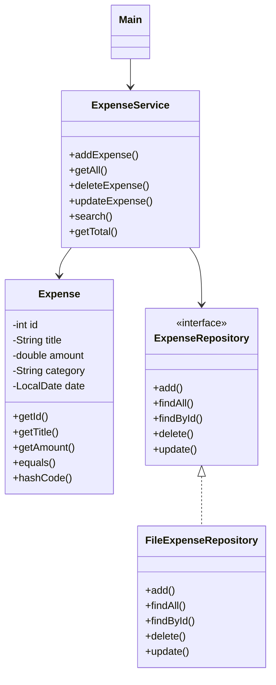

# UML and Design
## Class Diagram

## Use Case Summary
Actor: Local User
- Add expense
- View expenses
- Edit expense
- Delete expense
- Search expense
- Filter expenses
- View total spending
## Data Design
Expense fields:
ID, Title, Amount, Category, Date.
Storage: Local CSV file.